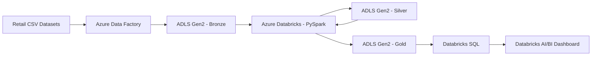

# Retail Sales Data Engineering Project

## End-to-End Architecture

## Technology Stack

- Azure Data Factory
- Azure Data Lake Storage Gen2
- Azure Databricks
- PySpark
- Delta Lake
- Databricks SQL
- Databricks AI/BI Dashboard

## Architecture Pattern

Medallion Architecture: Bronze → Silver → Gold.
