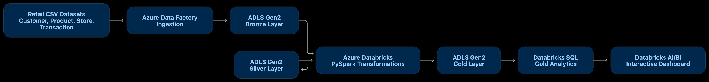

# Retail Sales Data Engineering Project

An end-to-end retail sales data engineering project built using Microsoft Azure and Databricks. The project demonstrates data ingestion, transformation, aggregation, and interactive business reporting using the Medallion Architecture.

## Project Overview

The objective of this project is to build a data pipeline that processes retail sales data and transforms raw datasets into structured, analytics-ready data.

The project uses a Bronze → Silver → Gold architecture to organize data processing and deliver meaningful retail sales insights through a Databricks AI/BI dashboard.

## Architecture



### Data Flow

1. **Source Data:** Retail datasets containing customer, product, store, and transaction information.
2. **Ingestion:** Azure Data Factory for data ingestion and orchestration.
3. **Bronze Layer:** Raw source data stored in Azure Data Lake Storage Gen2.
4. **Silver Layer:** Data cleaning, type casting, and transformation using PySpark.
5. **Gold Layer:** Aggregated retail sales data prepared for analytical queries.
6. **Analytics:** Databricks SQL used to query the Gold layer.
7. **Dashboard:** Databricks AI/BI Dashboard used to visualize business performance.

## Technology Stack

| Technology | Purpose |
|---|---|
| Azure Data Factory | Data ingestion and orchestration |
| Azure Data Lake Storage Gen2 | Data lake storage |
| Azure Databricks | Data processing and analytics |
| PySpark | Data transformation |
| Delta Lake | Structured storage for processed data |
| Databricks SQL | Analytical queries |
| Databricks AI/BI | Interactive dashboard |

## Medallion Architecture

### Bronze Layer
- Stores raw retail source datasets.
- Maintains the original source data for downstream processing.

### Silver Layer
- Performs data cleaning and transformation.
- Applies appropriate data types to columns.
- Creates structured datasets for further analysis.

### Gold Layer
- Aggregates sales data by transaction date, product, category, and store.
- Calculates total quantity sold, total sales amount, transaction counts, and average transaction value.
- Provides analytics-ready data for dashboard reporting.

## Dashboard and Business KPIs

The Databricks AI/BI dashboard provides an interactive view of retail sales performance.

### Key Performance Indicators

- Total Revenue: ₹134,570.74
- Total Quantity Sold: 101
- Total Transactions: 30
- Average Transaction Value: ₹4,485.69

### Dashboard Visualizations

- Monthly Revenue Trend
- Sales by Category
- Top 10 Products by Revenue
- Revenue by Location
- Revenue by Store

### Interactive Filters

- Sales Date Range
- Product Category
- Store Location

These filters allow users to explore sales performance across different time periods, product categories, and locations.

## Repository Structure

```text
retail-sales-data-engineering/
│
├── Architecture/
│   ├── Retail_Sales_Project_Architecture.md
│   └── Retail_Sales_Project_Architecture.png
│
├── Dashboard Screenshots/
│   └── Dashboard screenshots and PDF
│
├── Project Documentation/
│   └── Gold Table Evidence/
│       ├── Gold_Table_Sample_Records.xlsx
│       └── Gold_Table_Sample_Records.csv
│
├── PySpark Notebooks/
│   ├── retail-project-multiple-tables.py
│   └── retail-project-multiple-tables.ipynb
│
├── SQL Queries/
│   └── Retail_Sales_Analytics_Queries.sql
│
└── .gitignore
```

## Skills Demonstrated

- Azure Data Factory and Azure Data Lake Storage Gen2
- Data Lake organization using Medallion Architecture
- PySpark data transformations
- Delta Lake
- SQL aggregations and analytical queries
- Databricks AI/BI dashboard development
- Git and GitHub version control

## Project Outcome

Developed a retail sales analytics workflow that transforms raw retail datasets into structured Gold-layer data and presents business performance through an interactive Databricks dashboard.

The project demonstrates practical experience with cloud data storage, distributed data processing, analytical SQL, and business reporting.
